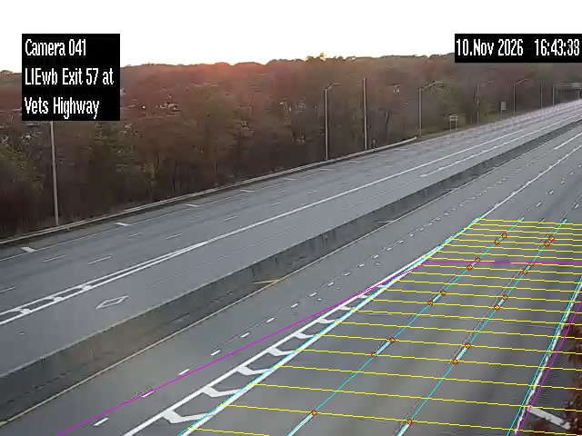

# cctv/: traffic speed analytics on Long Island Expressway cameras

Estimate how fast traffic moves past public NYSDOT cameras on the LIE (I-495) and show
it on a website: a camera map, speed distributions, and anonymous per-vehicle speed
estimates with ± uncertainty. This is **traffic analytics, not enforcement**: no plates,
no faces, no identities (see [docs/ARCHITECTURE.md §9](docs/ARCHITECTURE.md#9-ethics-privacy-and-legal-required-reading)).


*Camera R10_041 (LIE at Exit 57), 2026-11-10 16:40. Yellow boxes are vehicles inside the
calibrated stretch, labelled with their speed estimate ± 1σ in mph; grey boxes are
outside it. Video: NYSDOT / 511NY.*

## What's here

| Path | What it does |
|---|---|
| `docs/SOURCES.md` | Where the feeds come from (opencctv.org → 511NY/NYSDOT), terms, the measured fps and timing of 19 cameras, how many cameras can do speeds |
| `docs/ARCHITECTURE.md` | Website architecture: diagram, data model, ports, scaling, cost, error budget, validation plan, ethics, milestones |
| `data/cameras_lie.json` | **The camera manifest**: 129 cameras from the Queens-Midtown Tunnel to Riverhead |
| `data/feed_measurements.json` | Measured feed characteristics (resolution, fps, timestamp jitter, repeated frames) |
| `data/calibration/R10_041.*` | One calibrated camera: clicked points, fitted homography, reference frame |
| `registry.py` | Load the manifest |
| `geometry.py` | Pixel ↔ road-metre homography, calibration files |
| `speed.py` | Track → speed ± σ, rejects bad tracks, conservative over-limit flag |
| `camera_motion.py` | Detects that a pan-tilt-zoom camera was moved since calibration |
| `ingest.py` | Records short HLS clips; reads exact frame timestamps |
| `detect_track.py` | YOLO + ByteTrack over a clip (Stephen's `ByteTrackFinal.py` idea, offline) |
| `pipeline.py` | Clip → tracks → speeds → SQLite |
| `web/` | FastAPI site on port 8010: map, speed estimates, stats, calibration tool, About |
| `calibrate.py` | Calibration helper CLI: fit, draw a check grid, build an empty-road frame |
| `error_budget.py` | Monte Carlo of every error source for a calibrated camera |
| `recon/` | `build_manifest.py` (offline) and `measure_feed.py` (records 20 s per camera) |
| `tests/` | 42 pytest tests (no network, no YOLO needed) |

## Quickstart

Commands run from the **repo root** (`drone-ducks/`). They were tested on the 2019 Intel
MacBook with Python 3.12.

```bash
# 1. Make a venv inside cctv/ and install the light dependencies (no torch)
uv venv --python /usr/local/bin/python3.12 cctv/.venv
uv pip install --python cctv/.venv/bin/python -r cctv/requirements.txt
source cctv/.venv/bin/activate

# 2. Run the tests
python -m pytest cctv            # 42 passed

# 3. Start the site (it reads cctv/data/db/cctv.sqlite, which is empty on a fresh clone)
python -m cctv.web.app           # http://127.0.0.1:8010
```

To produce your own speed data you need the detection stack (torch, ultralytics; about
1 GB):

```bash
uv pip install --python cctv/.venv/bin/python -r cctv/requirements-detect.txt

# record 60 s from a camera (one stream, short clip: be a polite viewer)
python -m cctv.ingest --camera R10_041 --seconds 60

# detect + track + speeds -> SQLite (YOLO11n on CPU: ~2 min per minute of video here)
python -m cctv.pipeline --camera R10_041 --clip cctv/data/clips/R10_041_<timestamp>.ts

python -m cctv.web.app           # refresh the page
```

The pipeline first checks that the camera view still matches the calibration. LIE
cameras are pan-tilt-zoom, and **camera 041 was re-aimed within an hour of being
calibrated** on 2026-11-10. When the view has changed, tracks are stored without speeds
and the site says so. Re-calibrate the new view, or wait for the old preset to come back.

## Calibrating a camera

Speeds need a map from pixels to metres on the road. We use the lane markings: dashed
lines are 10 ft long with 30 ft gaps, and lanes are 12 ft wide.

```bash
python -m cctv.calibrate background --clip cctv/data/clips/<CAM>_<ts>.ts --out cctv/data/calibration/<CAM>.ref.jpg
# click dash corners in the browser: http://127.0.0.1:8010/calibrate (or write the JSON by hand)
#   -> save as cctv/data/calibration/<CAM>.points.json (copy R10_041.points.json for the format)
python -m cctv.calibrate fit --camera <CAM>                     # writes <CAM>.json, prints errors
python -m cctv.calibrate show --camera <CAM> --frame cctv/data/calibration/<CAM>.ref.jpg --out check.jpg
python -m cctv.error_budget --camera <CAM>                       # how good can speeds be here?
```



*Check grid: cyan lines every 12 ft across the road, yellow every 10 ft along it. They
should sit on the paint. Red rings are the clicked points; the magenta outline is the
stretch where speeds are measured.*

Gotcha: with only two parallel lane lines, the calibration cannot tell whether the road
is "sheared". Add two or more `transverse_lines` (points along concrete pavement joints,
which cross the road at right angles), as in `R10_041.points.json`.

## Results so far (all measured on 2026-11-10)

- **Sources:** the 129 LIE cameras are 108 NYSDOT HLS video streams (about 15 fps; 640×480
  in Nassau/Suffolk, 352×240 in Queens) and 21 NYC DOT still images (refreshed every
  ~2 s, so no speeds).
- **Feed timing:** frame timestamps on the Long Island encoders step 66.7 ms with 0.4 ms
  jitter. The east-end cameras drop and repeat frames, and burned-in clocks are minutes
  off.
- **Tracking:** YOLO11n + ByteTrack at 640 ran at 116 ms/frame on this CPU (shared). On
  R10_041's 60 s clip, 66 tracks touched the calibrated stretch, none fragmented, and 5
  had a gap of 3 or more frames.
- **Speeds on R10_041:**
  - 62 vehicles in 60 s; 54 got a speed.
  - Median 57.2 mph, p85 62.0, mean σ 1.7 mph (posted limit 55).
  - Every accepted track ran within 2° of the lane direction.
- **Error budget (60 mph):**
  - Box jitter, occlusion and timestamps each add under 0.6 mph.
  - Paint tolerance (±2.5%) adds ±1.5 mph and dominates.
  - An undetected 8 px camera nudge would cost −3 mph.
  - Realistic mix: −0.8 ± 1.5 mph.

**Not verified yet:**
- no ground truth (planned: a GPS-logged drive past a camera);
- the far half of each track reads ~4% slower than the near half (braking or a bias? to be
  investigated);
- night-time accuracy;
- the 55 mph limit in Nassau/Suffolk comes from secondary sources.

## Good first tasks

1. **Calibrate a second camera.**
   - Pick one marked `measured_good` in the manifest, e.g. R10_019 or R10_044.
   - Record a daytime clip, build the background frame, and click dash corners on
     `/calibrate`.
   - Fit, check the grid, run the error budget, and open a PR with the `.points.json`,
     `.json` and `.ref.jpg`.
2. **Re-measure feeds in daylight.**
   - Run `python -m cctv.recon.measure_feed --sample 20` around noon, then
     `python -m cctv.recon.build_manifest`.
   - R10_355 was measured after dark and needs a redo. Which cameras changed resolution?
3. **Compare with NYC DOT speeds.**
   - Write `cctv/recon/nyc_speeds.py` to fetch the LIE links (84th St–108th St) from NYC
     Open Data `i4gi-tjb9` for one afternoon.
   - Plot them next to our medians for R11_140/R11_141 (needs a Queens calibration).
4. **Speed up tracking.**
   - Export YOLO11n to OpenVINO (`yolo export format=openvino`) and compare ms/frame and
     detections against PyTorch on the same clip.
   - Report the numbers in this README.

## Rules of the road for this folder

- One stream at a time, clips of 60 s or less. Never commit video, frames, weights or
  databases; `cctv/.gitignore` covers them. The only images committed are calibration
  reference frames and the two docs images.
- No licence-plate reading, face detection or vehicle re-identification. Not now, not "just
  to test".
- Show uncertainty with every speed, and say "flagged over limit", never "speeder".
- Before anything runs continuously, the 511NY developer access request must be filed
  (see docs/SOURCES.md).
