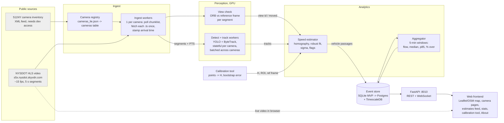

# Architecture: LIE traffic speed analytics

How to go from "public NYSDOT cameras on the Long Island Expressway" to "a website that
shows how fast traffic moves and how many vehicles exceed the posted limit". It covers
what the prototype in this folder already does, what a real deployment needs, and the
ethics and legal ground rules that apply throughout.

Status legend: **[built]** exists in this branch and was run; **[planned]** designed here, not built.

## 0. Feasibility verdict (details and citations in [SOURCES.md](SOURCES.md))

**Source and terms.**
- opencctv.org is an aggregator: the LIE cameras it lists are NYSDOT/511NY streams. Its
  robots.txt allows `/cameras/` pages and disallows `/api/`, and it has no terms page. We
  used it only for discovery (7 robots-allowed requests).
- The official source is 511NY/NYSDOT. Video is HLS from `s*.nysdot.skyvdn.com`, with no
  robots.txt. The 511NY Developer Access Agreement (updated 2026-09-18) allows
  redistribution with attribution, data timestamps and a passed-on disclaimer, but feed
  access needs a free request. **TODO (Eddie): file that request before any continuous
  ingest.**
- The 21 Queens NYC DOT cameras are 0.5 fps stills, and NYC DOT requires a data-sharing
  agreement, so they are not used.

**Measured.**
- 19 cameras measured: all NYSDOT feeds run at 14.99–15.00 fps with 5.005 s segments
  published in real time.
- Region 10 (Nassau/Suffolk) encoders: 640×480, frame-timestamp jitter 0.4 ms, no gaps,
  no repeated frames.
- Queens (Region 11): 352×240.
- The east-end 768×432 cameras drop frames (gaps up to 200 ms) and repeat up to 55%.

**Which LIE cameras can support per-vehicle speeds?**
- Candidates: the 85 mainline video cameras out of the 129 on the corridor.
- **Likely good: about 40–45 Region 10 cameras in Nassau/Suffolk**; 8 of 9 measured passed.
- Marginal: about 30 low-resolution Queens cameras and 9 east-end cameras.
- Snapshot only (counts or density at most): 21 NYC DOT cameras.
- Each good camera still needs a calibratable view, and PTZ moves invalidate it (seen for
  real on R10_041). Since round 2, a camera holds one calibration per PTZ preset, and
  each clip is matched to the preset it shows (section 3.4). Since round 3, a preset that
  comes back a few pixels off is compensated instead of rejected.
- **Proven end to end on 1 camera (R10_041):** 54 of 62 vehicles got speeds, median
  57 mph, σ about 1.7 mph.
- **TODO** (round 2 status, 2026-11-13):
  - [built, not yet run on real footage] ground-truth harnesses: NYC DOT link speeds
    (`groundtruth/nyc_links.py`) and GPS validation drives (`groundtruth/gps_drive.py`,
    protocol in [VALIDATION_DRIVE.md](VALIDATION_DRIVE.md)). **Still needed:** a
    calibrated camera on a usable link (daylight), and the drive itself;
  - [built] several calibrations per camera, one per PTZ preset (section 3.4);
  - calibrate R10_041 preset v2 (seen only at night so far) and a camera on the
    Little Neck Pkwy WB link (R10_007/R10_008, see 8.2). Mentee task. Daylight clips of
    R10_007/008 from 2026-11-17 16:27–16:47 exist locally. On 2026-11-17, R10_041 showed a
    third, wide preset that matched neither v1 nor v2;
  - run the 2026-11-17 night clip through the detector and compare with the sunset and
    twilight numbers (README, round 3);
  - test a larger detector (yolo11s / imgsz 960) on R10_008: about 50–58% of mid-field
    vehicles were tracked at sunset/twilight (eye count, 4 frames);
  - calibrate 4+ more cameras (mentee M1 task);
  - daylight re-measurement (R10_355 was dark);
  - live ingest and the GPU worker (sections 3.2, 3.3), after 511NY access;
  - Postgres;
  - WebSocket overlays;
  - [built, round 3] small-shift compensation: the matched similarity transform is
    applied to the calibration for nudges up to 30 px / 3% zoom / 2° (section 3.4);
  - [built, round 3] sun elevation and day/twilight/night label on every run
    (`daylight.py`), and the site says when a run is not daylight;
  - [built, round 3] committed regression fixture (real R10_041 tracks, boxes only) with
    pinned outputs (8.2 item 4);
  - [built, round 3] per-vehicle publication delay (`--publish-delay-min`, section 9);
  - [built, round 3] one-command daylight recorder `scripts/record_daylight.sh`.

## 1. The product in one paragraph

A map of the LIE's 129 public cameras. Cameras with real video and a calibration show the
**current median speed**, the **speed distribution**, and the **share of vehicles whose
estimated speed is over the posted limit** (beyond their uncertainty). Each camera has a
page with the live video, track overlays, and a feed of anonymous speed estimates, each
with ± uncertainty. Aggregates show speed by hour of day per camera. A calibration page
lets a person map a camera's pixels to road metres using lane markings. Everything is
framed as **traffic speed analytics**. Nothing identifies a vehicle or a driver, and
nothing claims to be enforcement evidence.

## 2. System diagram



ASCII version, for terminals:

```
511NY inventory --> registry --> ingest workers --(segments, PTS)--> detect+track (GPU) --tracks--> speed estimator --> DB --> API :8010 --> browser
NYSDOT HLS ---------------------^        \--> view check (PTZ) ------------------------------------^       ^            ^
                                                                        calibration tool (H, ROI) --/       aggregator --/
```

## 3. Components

### 3.1 Camera registry [built]
- `data/cameras_lie.json` holds 129 cameras with ids, coordinates, county, exit, kind
  (mainline, ramp, ...), feed URL, posted limit, measured feed characteristics, and a
  speed-suitability verdict. It is built offline by `recon/build_manifest.py` from a saved
  511NY snapshot (see `SOURCES.md`).
- [planned] Refresh it weekly from the official 511NY camera inventory feed once developer
  access is granted. Diff against the previous version and alert when cameras appear,
  disappear or change URL.

### 3.2 Ingest workers [built: offline recorder · planned: live]
- [built] `ingest.record_hls` records a clip with ffmpeg (`-c copy`, no re-encode) and
  logs when each segment arrived. `ingest.frame_times` reads every frame's PTS.
- [planned] One lightweight async worker per camera:
  - Poll the chunklist every ~2.5 s (half the target duration) and fetch each new `.ts`
    segment exactly once.
  - Keep the segment's media sequence number and arrival time. The PTS orders frames
    within and across segments; arrival time anchors them to wall-clock time, about
    5–20 s late.
  - Detect `EXT-X-DISCONTINUITY`, resolution changes and stalls, and publish health
    metrics (fps, unique fps, mean brightness).
  - Hand segments to the perception queue; keep nothing after processing.
- Bandwidth: about 240 kbit/s per camera, so all 108 cameras need about 26 Mbit/s
  continuously (~8 TB/month) from NYSDOT's servers. **Agree that with NYSDOT before going
  continuous** (section 9).

### 3.3 Detection and tracking [built: offline, CPU]
- [built] `detect_track.py`: Ultralytics YOLO11n with the COCO vehicle classes (car,
  motorcycle, bus, truck) and ByteTrack (`persist=True`, as in Stephen's
  `ByteTrackFinal.py`). Output is JSON lines `(frame, t, track_id, class, conf, box)`, so
  tracking runs once and the speed maths can be re-run instantly.
- Measured on Eddie's 2019 i9 MacBook (CPU, shared with other jobs): **116 ms/frame**
  mean (p90 125 ms) at imgsz 640, i.e. 8.6 fps. That is below real time for one 15 fps
  camera, so a laptop is fine for offline clips only.
- [planned] GPU workers. Each owns a shard of cameras, because ByteTrack is stateful per
  camera, and batches one frame from each of its cameras per inference call.
  TensorRT/FP16 export.

### 3.4 View check and PTZ presets [built]
- `camera_motion.py`: ORB features with on-screen-display text masked out, a RANSAC
  similarity transform against the calibration's reference frame, and thresholds of 4 px
  shift, 2% zoom and 1° rotation. Few matches means the camera points somewhere else.
- The pipeline compares the clip's median frame with
  `data/calibration/<id>.ref.jpg`. If the view moved, speeds are stored as rejected
  ("camera moved since calibration").
- **It already caught a real move.** Camera 041 was calibrated on a 16:39 clip. By 17:43
  the operator had turned it to face the other carriageway. The 17:43 clip got only 7
  feature matches, so its 7 tracks were stored without speeds, and the site says the
  camera was re-aimed and falls back to the last matching clip.
- **Several calibrations per camera** (`views.py`, round 2). Each PTZ preset is a *view*
  with its own files in `data/calibration/<CAM>/`:
  `<VIEW>.json` (calibration, optional), `<VIEW>.points.json`, `<VIEW>.ref.jpg`, and extra
  references such as `<VIEW>.ref-night.jpg`. `views.json` holds labels.
  - The pipeline compares the clip's median frame with every reference of every view.
    Views within the thresholds are candidates, and the one with the most RANSAC
    inliers wins. Its calibration is used, and the run records `view_id`.
  - Three outcomes: a calibrated view matches (speeds); a known but uncalibrated
    preset matches (counts only; "camera at preset v2, which is not calibrated"); or
    nothing matches (counts only; "view matches no calibrated preset").
  - Round-1 flat files (`<CAM>.json`, `<CAM>.ref.jpg`) still load, as the view
    `default`. `python -m cctv.calibrate migrate` moves them. R10_041 is migrated: v1
    is the calibrated 16:39 view, and v2 is the re-aimed 17:43 view, registered from a
    night reference and not calibrated.
  - **Checked on real frames:** the 16:39 clip and three stills taken 6–8 minutes
    later (16:45–16:48) match v1 with 86–1,081 inliers. The 17:43 clip and a 17:46
    still match v2. Each matched the other view with at most 7 feature matches.
    Caveat: each view's reference was built from one of those two clips, so only the
    stills are independent checks.
  - CLI: `calibrate views | add-view | match | migrate`, `--view` on
    `fit`/`show`/`error_budget`/`pipeline`.
  - **Small-offset compensation** (round 3). Presets don't always return to exactly the
    same pixel, and the error budget (8.1) shows an undetected 8 px nudge costs about
    −3 mph. When the only thing wrong with a match against a view's *calibration frame*
    (`<VIEW>.ref.jpg`) is a shift up to 30 px, zoom within 3% or roll within 2°, and the
    fit is well supported (≥ 40 matches, ≥ 40% RANSAC inliers), the pipeline uses the
    calibration moved by the measured transform (H' = H·M⁻¹; ROI moved too) and stores
    `view_shift_px` on the run. Extra references (`ref-night`) are never used for this,
    because they need not be aligned with the frame the points were clicked on. Treating
    a small pan/tilt as a 2-D similarity ignores the perspective change, which is small
    at these angles; synthetic tests recover speed within 0.05 mph. Not yet seen on a
    real nudged clip.
  - Limits: one daytime reference per view so far, so a night clip of v1 will probably
    read as "no match" until someone adds a `ref-night`. That is conservative but loses
    data. [planned] Per segment in live mode; a cheap global fingerprint to pre-select
    views when a camera has many.

### 3.5 Speed estimator [built]
- `geometry.py`: the road-plane homography. Image (u, v) maps to road (X along the lanes,
  Y across), fitted by normalised DLT.
- `calibrate.py`: lane-dash corners give known road coordinates (10 ft dash, 30 ft gap,
  12 ft lanes). The dash phase of a second lane line is solved from transverse pavement
  joints; without them the frame's shear is unobservable, which the tool reports. A
  bootstrap over the points gives the speed-scale uncertainty, and a 2.5% systematic term
  covers paint tolerance (±1 ft per 40 ft cycle).
- `speed.py`:
  - Track the bottom-centre of each box, keep points inside the camera's ROI, and map
    them to the road.
  - Fit X(t) and Y(t) with Theil–Sen, then iterate weighted least squares on inliers.
    Weights come from the homography Jacobian, so far pixels, which cover more road,
    count less.
  - The 1-sigma uncertainty combines the fit error (inflated for frame-to-frame
    correlation), calibration scale and timing.
  - Rejection rules: too few points or too short, travel under 8 m, jumpy (under 70%
    inliers), heading more than 25° off the road axis, over 120 mph, or fit sigma over 8%.
  - Flag: `estimate − max(2σ, 3 mph) > posted limit`.

### 3.6 Event store [built: SQLite · planned: Postgres + TimescaleDB]
See section 4. SQLite is enough for the prototype (one writer, a few thousand rows). The
schema carries over to Postgres; `vehicle_passages` becomes a TimescaleDB hypertable,
with continuous aggregates for the 5-minute windows and compression after 7 days.

### 3.7 API [built]
FastAPI on **:8010** (`web/app.py`):

| Endpoint | Purpose |
|---|---|
| `GET /api/cameras` | All cameras with their latest run's stats |
| `GET /api/cameras/{id}` | One camera's details |
| `GET /api/events` | Anonymous estimates |
| `GET /api/stats` | Histogram, by-hour aggregates, classes, reject reasons |
| `GET /api/runs/{id}/overlay` | Track polylines with timestamps for the replay overlay |
| `POST /api/calibrate/fit` | Stateless calibration fit; nothing is saved |

[planned] `WS /ws/cameras/{id}`: live overlay messages (track id, class, box, speed so
far) tagged with the HLS media sequence and PTS, so the browser can align them with the
video it is playing.

### 3.8 Frontend [built]
Static HTML/JS (no build step) served by the API:

- **Map:** Leaflet/OSM with all 129 cameras. Filled markers mean processed footage,
  coloured by median speed on a colour-blind-safe ramp; a white ring means calibrated.
  Hollow markers are video cameras without data; small grey dots are still-image cameras.
- **Camera panel:** feed facts, calibration quality, latest-clip stats (median, p85,
  share flagged), speed histogram with the limit line, a time-slider replay of tracks on
  the reference frame, an estimates table with ±σ, and a live HLS player.
- **Speed estimates feed:** all cameras, with a filter for flagged estimates only.
- **Calibrate:** click dash corners, fit, see a 10 ft grid drawn over the image.
- **About and ethics:** visible from every page. A footer disclaimer is on every page.

## 4. Data model

Prototype (SQLite, `store.py`):

```
cameras(id PK, name, owner, lat, lon, county, kind, exit, chainage_km, feed_type, feed_url,
        posted_limit_mph, speed_suitability, measured_json)
runs(id PK, camera_id FK, source, processed_utc, clip_start_utc, clip_start_note, duration_s,
     frames, fps, model, tracker, ms_per_frame, calibration_utc, calibration_rmse_m,
     scale_uncertainty, camera_moved, motion_json, reference_frame, notes,
     view_id)     -- round 2; added to old databases by ALTER TABLE on connect
vehicles(id PK, run_id FK cascade, camera_id, track_id, cls, ts_utc, t_start, t_end, n_points,
         n_inliers, distance_m, speed_mph, sigma_mph, sigma_stat_mph, sigma_cal_mph, direction,
         heading_deg, accepted, reject_reason, limit_mph, margin_mph, over_limit)
track_points(vehicle_id FK cascade, t, u, v, x, y, in_roi)        -- 7-day retention
VIEW speed_events = vehicles WHERE accepted AND over_limit
```

Production (Postgres + TimescaleDB) adds:

```
camera_views(id, camera_id, fingerprint, first_seen, last_seen)          -- PTZ presets
calibrations(id, camera_view_id, created_at, author, H jsonb, roi polygon, points jsonb,
             rmse_m, scale_uncertainty, valid_from, valid_to)
ingest_health(camera_id, ts, online, fps, unique_fps, luma, segment_lag_s, view_moved)  -- hypertable
vehicle_passages(... as vehicles ..., view_id, calibration_id, lane, direction)          -- hypertable on ts
agg_5min(camera_id, direction, bucket, n, flow_vph, median_mph, p85_mph, pct_over, mean_sigma)  -- continuous aggregate
```

The design is anonymous by construction: a "vehicle" is `(run or window, track_id)` and
means nothing outside that window. There is no image column anywhere.

## 5. Process and port map

| Process | Where | Port | Notes |
|---|---|---|---|
| Web app + API (prototype) | `python -m cctv.web.app` | **8010** | CCTV track owns 8010–8019 on the shared Mac |
| Second dev instance / WebSocket overlay (planned) | | 8011 / 8012 | |
| Ingest workers (planned) | 1 asyncio task per camera | none | outbound HTTPS to NYSDOT only |
| Queue (planned) | Redis | 6379 (localhost) | segment and track messages |
| GPU detect/track workers (planned) | 1 per GPU | none | consume segments, emit tracks |
| Speed estimator + aggregator (planned) | CPU | none | consume tracks, write DB |
| Postgres/TimescaleDB (planned) | | 5432 (localhost) | |
| Reverse proxy (planned) | Caddy/nginx | 443 | TLS, rate limits, cache static |

The drone-sim ports (50000, 50049/50050, 5601, 14540/14550) and the Jetson ports
(8020–8029) are untouched.

## 6. Scaling estimate

Frames per second to process = cameras × processed fps.

| Scenario | Cameras | fps processed | Frames/s | Compute |
|---|---|---|---|---|
| Laptop pilot (offline clips) | 1 | 15 | 15 | i9 CPU at 116 ms/frame, about 0.5× real time |
| Pilot, live | 10 | 7.5 | 75 | One T4 (≈1.5 ms/frame for YOLO11n TensorRT at batch 1) uses ~11% of the GPU; or an 8-core CPU box with OpenVINO (unmeasured) |
| All mainline video | 85 | 7.5 | 640 | ~1.0 GPU-s per s at batch-1 speed, so **1 T4 with batching, 2 to be safe** |
| All video, full rate | 108 | 15 | 1,620 | 2–3 T4 |

Why 7.5 fps is enough: the error budget below shows the fit's statistical error is about
0.3 mph at 15 fps. At 7.5 fps it grows by √2, to about 0.4 mph, still far below the 1.5 mph
calibration term. Skipping every other frame halves GPU cost. The T4 figure is from the
[Ultralytics YOLO11 table](https://docs.ultralytics.com/models/yolo11/) (T4 TensorRT10,
1.5 ms at 640, accessed 2026-11-10). Real throughput includes decode, NMS and tracking, so
measure before buying.

Storage, with 40 good cameras at about 50,000 vehicles per camera-direction per day (we
counted 62 vehicles a minute through one ROI at 4:40 pm):

- **Passages:** about 2 M rows/day × ~150 B is about 300 MB/day raw, or roughly 1 GB/month
  after TimescaleDB compression. Keep raw passages 90 days and aggregates indefinitely.
- **Track points:** about 20 per vehicle, so about 40 M rows/day. This is why they have a
  7-day retention, or are only sampled.

## 7. Hosting cost (prices checked 2026-11-10)

| Item | Price | Monthly |
|---|---|---|
| AWS g4dn.xlarge (T4), us-east-1 on-demand | $0.526/h ([AWS](https://aws.amazon.com/ec2/pricing/on-demand/)) | $384 at 24/7; ~$225 daylight only (14 h) |
| RunPod L4 (24 GB) | $0.44/h community, $0.59/h secure ([RunPod](https://www.runpod.io/pricing)) | $320–430 at 24/7 |
| API + DB VPS | DigitalOcean basic from $6/month for 1 GB ([DO](https://www.digitalocean.com/pricing/droplets)); use a 4 GB size for TimescaleDB (check price) | ~$6–25 |
| Inbound video, ~8 TB/month | free inbound on AWS; NYSDOT pays its egress, so coordinate | – |

The cheapest credible setup is daylight-only (night accuracy is poor anyway; see section
8) on one T4 plus a small VPS: **about $250/month**. A university GPU, if the program has
one, brings the compute cost to zero.

## 8. Accuracy: error budget and validation

### 8.1 Error budget (camera R10_041, 60 mph)
From `python -m cctv.error_budget --camera R10_041 --mph 60`: synthetic vehicles in each
lane of the ROI, 22 frames per track over 37 m, run through the real estimator.

| Error source | Bias (mph) | Spread σ (mph) | Comment |
|---|---|---|---|
| bbox jitter 1 / 2 / 4 px | 0.0 | 0.27 / 0.55 / 1.11 | YOLO boxes on 640×480 jitter 1–2 px |
| occlusion 10% of frames | 0.0 | 0.31 | robust fit drops the jumps |
| occlusion 25% of frames | 0.0 | 0.40 | but 34% of tracks are rejected |
| timestamp jitter 0.5 ms (measured PTS) | 0.0 | 0.24 | negligible: use PTS |
| timestamp jitter 30 ms (arrival times) | −0.2 | 1.37 | why we never time by arrival |
| repeated frames 10% / 50% | 0.0 / −2.9 | 0.31 / 2.21 | 50% is the east-end cameras' case |
| dash cycle 41 ft / 39 ft instead of 40 | −1.5 / +1.6 | 0.3 | **dominant systematic: paint tolerance** |
| camera nudged 2 px / 8 px, undetected | −0.8 / −3.1 | 0.3 | the 4 px motion threshold caps this near −1.5 |
| loose boxes (bottom 5% of box height low) | 0.0 | 0.27 | a constant offset barely matters |
| **realistic mix** | **−0.8** | **1.45** | 95% of errors within 3.2 mph |

On the real clip (R10_041, 2026-11-10 16:39 local), 62 vehicles crossed the ROI in 60 s
and 54 got a speed: median 57.2 mph, p85 62.0 mph, mean σ 1.7 mph. Every accepted track's
heading was within 2° of the lane axis, a good sign the calibration's axes are right.

One internal check is open. Fitting each track's near half and far half separately, the
far half reads a median **4% slower**. That could be real braking into the queue visible
further west, lens distortion near the image edge, or box-bottom bias on small, distant
vehicles. The ground-truth drive (8.2) is how we find out.

### 8.2 Validation plan
1. **Ground-truth drive** [tooling built: `groundtruth/gps_drive.py`, protocol in
   [VALIDATION_DRIVE.md](VALIDATION_DRIVE.md)].
   - A mentee drives past R10_041 (or another calibrated camera) on cruise control at a
     steady legal speed, logging phone GPS (Doppler speed, about ±0.2 m/s).
   - We record the stream at the same time with `record_hls`.
   - The car is matched by time window, lane, class and colour, by eye; we never use
     plates.
   - 10 passes over 2–3 lanes and both directions. Report bias and spread against GPS,
     then fold the bias into the calibration.
2. **Public speed data** [harness built: `python -m cctv.groundtruth.nyc_links`].
   - NYC DOT Traffic Speeds (`i4gi-tjb9`). A snapshot fetched 2026-11-12 has 4 live
     LIE links. The tool finds the NYSDOT video cameras on them:
     - EB/WB 84th St–108th St: R11_140, R11_141, R11_142 (352×240);
     - WB Little Neck Pkwy → CIP/CVE: R10_005–R10_008 (Region 10 encoders) and
       R11_154/155/254/255/269/287.
   - The comparison uses the **harmonic mean** of our spot speeds, which estimates
     space-mean speed, against the mean of link rows within ±10 min of the clip. It
     uses the same direction only, from the calibration's `direction_labels`, and
     shows a bootstrap 95% CI.
   - **Link quality check** (`quality`), 2026-11-12 02:00–05:00, light traffic:
     - Little Neck WB read a plausible 54.7 mph median.
     - EB 84th–108th St read 20.8 mph. That is implausible for 3 am free flow,
       unless there was an overnight work zone.
     - WB 108th–84th St: 36 of 48 rows had status −101, with values from 0 to
       114 mph. Non-"0" status rows are now skipped.
   - So the **first camera to calibrate for this comparison is R10_007 or R10_008 on
     the Little Neck WB link**, not R11_140. That is not verified in daylight.
   - **Latency (2026-11-17):** at 16:40 local the newest Little Neck row was from 14:27,
     with `X-SODA2-Data-Out-Of-Date: true`. Fetch link rows hours after a session,
     not during it. A query with no time filter timed out after 60 s, so always filter
     by time.
   - Caveats: link speed is a minutes-long, mile-long space-mean, while ours is a
     60 s spot sample. Disagreement in congestion doesn't prove either is wrong.
     `data_as_of` is assumed to be NY local time. The API flagged its copy as out of
     date on every request, and two queries minutes apart disagreed about the newest
     row.
3. **Consistency checks** that run automatically:
   - near half against far half of each track (above);
   - adjacent cameras on the same carriageway (medians should agree within a few mph in
     free flow);
   - both carriageways when both are calibrated.
4. **Regression tests:** synthetic tracks with known speed (`tests/test_speed.py`), plus a
   committed sample of real tracks with expected outputs [built, round 3:
   `tests/data/r10_041_v1_20261110T213935Z.tracks.jsonl.gz`, 66 KB, bounding boxes only,
   pinned by `tests/test_regression_r10_041.py`].

## 9. Ethics, privacy and legal (required reading)

- **Anonymous tracks only.**
  - A per-vehicle record holds a track id that is meaningless outside its clip, a class,
    a time, a camera, and a speed estimate ± uncertainty. Nothing more.
  - **No licence-plate reading**, no face detection, no colour/make/model profiling, and
    no linking of vehicles across cameras or days. Re-identification is out of scope by
    design and must stay out.
  - At most a low-resolution crop may ever be shown. The prototype shows none: its only
    image is a median-of-frames empty-road reference.
- **Estimates, not evidence.** In New York, automated speed enforcement is created by
  statute and run by government:
  - NYC school zones, [VTL §1180-b](https://www.nysenate.gov/legislation/laws/VAT/1180-B);
  - highway work zones (NYSDOT, Thruway and others),
    [VTL §1180-e](https://www.nysenate.gov/legislation/laws/VAT/1180-E).

  Both rely on certified equipment and sworn technician certificates. Our numbers are
  statistical estimates with stated uncertainty. They must never be presented as proof
  that a specific vehicle broke the law. The UI says so on every page, flags only beyond
  2σ plus a 3 mph floor, and calls flagged rows "flagged over limit", never "violations"
  or "speeders".
- **Feed terms and attribution.**
  - Follow the 511NY Developer Access Agreement: file the request before anything
    continuous; show data timestamps; attribute NYSDOT/511NY; no implied endorsement, so
    no 511NY logo until access is approved; pass on NYSDOT's disclaimer (done on the
    About page).
  - Do not use NYC DOT cameras without their data-sharing agreement.
  - Keep request rates at single-viewer levels. Do not bypass blocks.
  - opencctv.org is used only via robots-allowed pages, for discovery.
- **Retention:**
  - research clips are deleted after processing, and never committed (gitignored);
  - per-frame track points are kept for at most 7 days (`store.purge_track_points_older_than`);
  - passages are kept 90 days; aggregates are kept indefinitely.
- **Publication policy for a public site:**
  - aggregates first;
  - per-vehicle rows only as anonymous estimates, delayed by at least 15 minutes, with no
    imagery [built: `python -m cctv.web.app --publish-delay-min 15` withholds events and
    track replays younger than that; aggregates are not delayed];
  - a removal and contact route.
- **Security:**
  - the calibration endpoint is stateless and writes nothing;
  - admin actions (calibration saves, camera enable/disable) belong behind authentication
    in any deployment;
  - no raw video is stored.

## 10. Phased milestones

| Phase | Scope | Exit criteria |
|---|---|---|
| 0 [done] | Recon, manifest of 129 cameras, feed measurements (19 cameras), 1 calibrated camera, offline pipeline, SQLite, site on :8010, error budget, 41 tests | `pytest` green; R10_041 clip shows plausible speeds with σ |
| 1 (weeks 1–3) | Request 511NY access. Calibrate 5 good cameras (R10_011, R10_014, R10_017, R10_019, R10_044). Ground-truth drive. Re-measure feeds in daylight. ~~Multiple PTZ presets per camera~~ (built in round 2). Link-speed comparison on R10_007/008. | Bias against GPS under 2 mph, σ under 2 mph on at least 2 cameras |
| 2 (weeks 4–8) | Live ingest workers and a GPU worker (T4 or a university GPU). Postgres/TimescaleDB with 5-min aggregates. WebSocket live overlays. Health dashboard. Daylight scheduling. | 10 cameras live for a week with under 5% downtime |
| 3 (later) | All good cameras. Fine-tune the detector on LIE frames. Night mode (headlight pairs). Semi-automatic calibration (vanishing points + dash detection). Public site with rate limits and the publication policy. | Documented accuracy per camera, published methodology |
